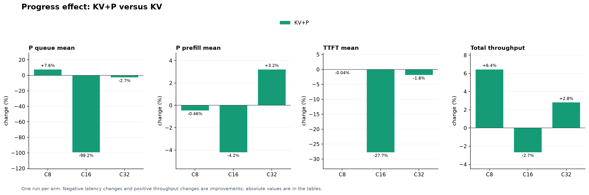
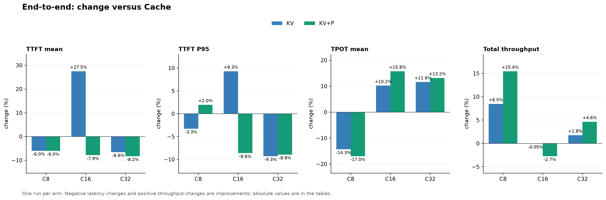

<!-- colocated-prefill-pressure:start -->
## Performance

### Experiment setup

| Item | Setting |
| --- | --- |
| Topology | Four colocated B300 workers, one GPU per worker; Qwen3-4B-Instruct-2507, BF16, TP1 |
| vLLM | 48 GiB GPU KV (349,520 tokens) and 16 GiB CPU KV offload per worker, with self-describing KV events; prefix caching enabled; max model length 196,608; max batched tokens 131,072; max 16 sequences per worker |
| Workload | AgentInfer replays the same AgentX subset: 128 sessions, up to four rounds plus subagent requests, 721 requests, 33,618,176 input and 425,651 output tokens. AgentInfer reconstructs token IDs from the trace hash snapshots. |
| Replay | C is the maximum concurrent sessions: C8, C16 and C32; at most one in-flight request per session; trace timing with same-agent gaps scaled to zero. Each arm starts with a cold cache and runs once. |
| Policies | Cache = cache-aware; KV = KV-aware without affinity; KV+P = KV with prefill progress. KV temperature 0; Cache threshold 0.3, balance thresholds 64/1.5. Progress stale threshold 5 s. |
| Versions | vLLM `d16847dafe12`; Router base `6a9014e52f92`. KV arms and all C32 arms use the event-limit build; C8/C16 Cache used the base build and does not subscribe to KV events. |

The event-limit benchmark build (binary SHA256 `d8692c7dd733…`) has the same production decoder change as commit `fed842de6c0a`: up to 65,536 events per batch with the existing 16 MiB payload cap. Its source differs in test code and comments. These measurements predate the capability-cache and unknown-context tie fixes and do not measure the latest PR head. All reported runs completed 721 requests; KV runs had no logged event decode/replay errors. The host was shared, with no foreign processes on the selected devices. C8/C16 used GPUs 2/3/6/7; C32 uses 2/3/4/7. One run per arm does not establish repeatability.

### 1. What does prefill progress improve?

Compare KV → KV+P at the same concurrency. Percentages are changes from KV; lower is better for latency and work, higher for throughput. P queue and P prefill are worker stage means, not pure GPU compute.

| C | Local P hit, % | New P tokens, M | P queue, ms | P prefill, ms | TTFT mean / P95, ms | Total token/s |
| ---: | --- | --- | --- | --- | --- | --- |
| 8 | 70.02 → 70.15 (+0.14 pp) | 10.08 → 10.03 (-0.46%) | 0.20 → 0.21 (+7.56%) | 365.71 → 364.05 (-0.46%) | 396.08 → 395.94 (-0.04%) 1,607.98 → 1,694.96 (+5.41%) | 78,358 → 83,398 (+6.43%) |
| 16 | 67.47 → 68.66 (+1.18 pp) | 10.88 → 10.52 (-3.29%) | 153.18 → 1.26 (-99.18%) | 433.08 → 414.94 (-4.19%) | 647.43 → 467.89 (-27.73%) 2,205.30 → 1,843.76 (-16.39%) | 90,054 → 87,657 (-2.66%) |
| 32 | 22.18 → 22.77 (+0.59 pp) | 24.37 → 24.76 (+1.60%) | 3,750.02 → 3,649.16 (-2.69%) | 1,192.61 → 1,230.86 (+3.21%) | 5,158.35 → 5,064.82 (-1.81%) 14,217.81 → 14,271.60 (+0.38%) | 74,894 → 76,992 (+2.80%) |

- **C8:** Mean TTFT is essentially unchanged; P95 rises. New P work and queue are nearly unchanged, so this run does not show a clear prefill-stage benefit.
- **C16:** P queue falls from 153.18 to 1.26 ms and mean TTFT falls 27.73%. Only 349/721 matched requests have lower TTFT; the five largest reductions total 78.10 s against a 129.45 s net reduction. The average is sensitive to the long tail.
- **C32:** P queue falls while P prefill rises. Despite higher local hit, external reuse falls 1.79 M → 1.20 M (-32.84%), and newly computed P work rises 1.60%. The 587,360 fewer external-hit tokens exceed the 196,704 additional local-hit tokens; stage timings also depend on scheduling. Progress was accepted 4,373 times. 405/721 matched requests had lower TTFT and 316 had higher TTFT. These are closed-loop observations, not per-decision counterfactuals.

### 2. End-to-end: KV-aware versus Cache-aware

Changes in parentheses are relative to Cache at the same concurrency. Total throughput is (logical input + output tokens) / replay wall time and includes cached input.

| C | Policy | TTFT mean / P95, ms | TPOT mean, ms | Session JCT mean, s | Total token/s |
| ---: | --- | --- | ---: | ---: | ---: |
| 8 | Cache | 421.33 1,662.16 | 6.91 | 24.97 | 72,240 |
| 8 | KV | 396.08 (-5.99%) 1,607.98 (-3.26%) | 5.92 (-14.31%) | 22.91 (-8.24%) | 78,358 (+8.47%) |
| 8 | KV+P | 395.94 (-6.03%) 1,694.96 (+1.97%) | 5.73 (-16.96%) | 22.12 (-11.43%) | 83,398 (+15.45%) |
| 16 | Cache | 507.76 2,017.55 | 10.16 | 34.20 | 90,103 |
| 16 | KV | 647.43 (+27.51%) 2,205.30 (+9.31%) | 11.20 (+10.21%) | 34.46 (+0.77%) | 90,054 (-0.05%) |
| 16 | KV+P | 467.89 (-7.85%) 1,843.76 (-8.61%) | 11.77 (+15.76%) | 34.23 (+0.09%) | 87,657 (-2.72%) |
| 32 | Cache | 5,520.09 15,671.51 | 18.94 | 80.01 | 73,584 |
| 32 | KV | 5,158.35 (-6.55%) 14,217.81 (-9.28%) | 21.14 (+11.62%) | 78.76 (-1.57%) | 74,894 (+1.78%) |
| 32 | KV+P | 5,064.82 (-8.25%) 14,271.60 (-8.93%) | 21.44 (+13.18%) | 78.89 (-1.41%) | 76,992 (+4.63%) |

- **C8:** KV+P lowers mean TTFT 6.03% and raises total throughput 15.45% versus Cache. The newly computed P tokens differ by only 0.36%; these observations do not establish cache reuse as the cause of the throughput difference.
- **C16:** KV+P lowers mean TTFT 7.85% but raises mean TPOT 15.76% and lowers total throughput 2.72%. The same token volume takes 377.83 → 388.38 s. The data shows a prefill/decode trade-off, but this single run cannot prove which scheduling decisions caused it.
- **C32:** Versus Cache, KV+P changes new P work by +3.70%, P queue by -10.82%, and mean TPOT by +13.18%. The tables show the associated end-to-end changes; these aggregates do not isolate the effect of individual routing decisions.
- **C32 cache tiers:** Cache → KV local hit changes 19.66 → 22.18 (+2.52 pp); external KV reuse changes 3.13 M → 1.79 M (-42.85%), and new P work changes +2.07%. The local hit rate alone does not account for CPU/offloaded reuse.

#### Why can C32 throughput fall versus C16?

Each cell compares C16 → C32 for the same policy; C32 uses a different set of four B300 GPUs. Latency increases and throughput decreases are regressions.

| Policy | Local P hit, % | New P tokens, M | P queue, ms | P prefill, ms | TPOT mean, ms | Total token/s |
| --- | --- | --- | --- | --- | --- | --- |
| Cache | 68.93 → 19.66 (-49.27 pp) | 10.36 → 23.88 (+130.55%) | 30.81 → 4,091.71 (132.8×) | 424.21 → 1,260.23 (+197.08%) | 10.16 → 18.94 (+86.38%) | 90,103 → 73,584 (-18.33%) |
| KV | 67.47 → 22.18 (-45.29 pp) | 10.88 → 24.37 (+124.05%) | 153.18 → 3,750.02 (24.5×) | 433.08 → 1,192.61 (+175.38%) | 11.20 → 21.14 (+88.77%) | 90,054 → 74,894 (-16.84%) |
| KV+P | 68.66 → 22.77 (-45.89 pp) | 10.52 → 24.76 (+135.39%) | 1.26 → 3,649.16 (2,895.4×) | 414.94 → 1,230.86 (+196.64%) | 11.77 → 21.44 (+82.22%) | 87,657 → 76,992 (-12.17%) |

- **Capacity and reuse:** Cache worker P95 KV usage is 98.0–99.0% at C32. Mean sampled capacity-waiting requests per worker rise 0.01 → 1.44; 634/721 matched trace requests have higher TTFT. The replay changes request arrival times and placements across concurrency levels. The measurements support capacity pressure and less reuse; they do not isolate their individual effects on throughput.
- **Actual work versus logical throughput:** For Cache, newly computed P tokens per wall second rise 27,413 → 51,614 (+88.28%), but the same logical workload requires 130.55% more new P tokens and 22.45% more wall time. This rate is a work proxy, not FLOPs or GPU efficiency.

Input/output throughput and full latency distributions

TTFT and TPOT are per request. Client-observed TPOT is estimated as (request latency − TTFT) / (output tokens − 1), excluding one request with a single output token; it includes transport and stream completion overhead. JCT is the replayed session duration, including its multiple model requests; no real tools are executed. Distributions are mean / P50 / P95 / P99. Input, output and total throughput have the same relative change because token counts are fixed.

| C | Policy | Input / output / total token/s | TTFT, ms | TPOT, ms | Session JCT, s |
| ---: | --- | --- | --- | --- | --- |
| 8 | Cache | 71,336 / 903 / 72,240 | 421.33 / 137.06 / 1,662.16 / 2,987.45 | 6.91 / 5.29 / 20.86 / 28.30 | 24.97 / 11.43 / 107.40 / 170.19 |
| 8 | KV | 77,378 / 980 / 78,358 | 396.08 / 105.46 / 1,607.98 / 2,881.50 | 5.92 / 5.15 / 10.11 / 17.72 | 22.91 / 11.24 / 105.40 / 141.90 |
| 8 | KV+P | 82,355 / 1,043 / 83,398 | 395.94 / 102.55 / 1,694.96 / 2,840.28 | 5.73 / 5.08 / 9.27 / 14.04 | 22.12 / 11.23 / 98.66 / 137.66 |
| 16 | Cache | 88,977 / 1,127 / 90,103 | 507.76 / 144.15 / 2,017.55 / 5,154.00 | 10.16 / 8.76 / 17.85 / 34.24 | 34.20 / 18.91 / 123.80 / 220.88 |
| 16 | KV | 88,928 / 1,126 / 90,054 | 647.43 / 160.08 / 2,205.30 / 8,327.28 | 11.20 / 9.23 / 20.52 / 44.74 | 34.46 / 20.13 / 123.96 / 213.21 |
| 16 | KV+P | 86,561 / 1,096 / 87,657 | 467.89 / 157.27 / 1,843.76 / 3,696.74 | 11.77 / 9.14 / 18.68 / 55.48 | 34.23 / 20.18 / 119.10 / 225.39 |
| 32 | Cache | 72,664 / 920 / 73,584 | 5,520.09 / 4,130.64 / 15,671.51 / 21,827.12 | 18.94 / 15.47 / 36.03 / 130.45 | 80.01 / 57.61 / 279.05 / 362.62 |
| 32 | KV | 73,957 / 936 / 74,894 | 5,158.35 / 4,248.54 / 14,217.81 / 17,888.11 | 21.14 / 15.74 / 40.77 / 190.57 | 78.76 / 56.44 / 245.27 / 361.69 |
| 32 | KV+P | 76,029 / 963 / 76,992 | 5,064.82 / 3,713.91 / 14,271.60 / 18,636.64 | 21.44 / 16.81 / 41.68 / 213.66 | 78.89 / 56.49 / 232.37 / 361.38 |

Distribution changes below are relative to Cache at the same concurrency (mean / P50 / P95 / P99).

| C | Policy | TTFT change | TPOT change | Session JCT change |
| ---: | --- | --- | --- | --- |
| 8 | KV | -5.99% / -23.05% / -3.26% / -3.55% | -14.31% / -2.79% / -51.52% / -37.41% | -8.24% / -1.63% / -1.86% / -16.62% |
| 8 | KV+P | -6.03% / -25.17% / +1.97% / -4.93% | -16.96% / -4.11% / -55.56% / -50.38% | -11.43% / -1.71% / -8.14% / -19.12% |
| 16 | KV | +27.51% / +11.05% / +9.31% / +61.57% | +10.21% / +5.39% / +14.93% / +30.67% | +0.77% / +6.43% / +0.12% / -3.48% |
| 16 | KV+P | -7.85% / +9.11% / -8.61% / -28.27% | +15.76% / +4.29% / +4.65% / +62.04% | +0.09% / +6.74% / -3.80% / +2.04% |
| 32 | KV | -6.55% / +2.85% / -9.28% / -18.05% | +11.62% / +1.75% / +13.15% / +46.09% | -1.57% / -2.04% / -12.11% / -0.25% |
| 32 | KV+P | -8.25% / -10.09% / -8.93% / -14.62% | +13.18% / +8.68% / +15.68% / +63.79% | -1.41% / -1.96% / -16.73% / -0.34% |

Worker-level cache, work, queue and prefill

Local hit = locally cached prompt tokens / prompt tokens. New P = first-computed prompt tokens; iteration tokens include prefill and decode and are a work proxy, not FLOPs. Queue/prefill percentile values are Prometheus histogram bucket bounds. Colocated workers share P/D cache; there is no P→D KV transfer and preemptions cannot be split into P versus D.

| C | Policy | Local hit % | New P / iteration / external KV tokens | Queue mean / P50 / P95 / P99, ms | Prefill mean / P50 / P95 / P99, ms | Decode mean, s | Preemptions | Requests W0/W1/W2/W3 |
| ---: | --- | ---: | --- | --- | --- | ---: | ---: | --- |
| 8 | Cache | 70.05 | 10,069,344 / 10,494,995 / 160 | 0.25 / 0–300 / 0–300 / 0–300 | 380.63 / 0–300 / 1,500–2,000 / 2,500–5,000 | 3.92 | 0 | 189/200/179/153 |
| 8 | KV | 70.02 | 10,079,856 / 10,505,507 / 144 | 0.20 / 0–300 / 0–300 / 0–300 | 365.71 / 0–300 / 1,500–2,000 / 2,500–5,000 | 3.57 | 0 | 195/202/144/180 |
| 8 | KV+P | 70.15 | 10,033,200 / 10,458,851 / 160 | 0.21 / 0–300 / 0–300 / 0–300 | 364.05 / 0–300 / 1,500–2,000 / 2,500–5,000 | 3.43 | 0 | 164/206/183/168 |
| 16 | Cache | 68.93 | 10,357,408 / 10,783,059 / 86,688 | 30.81 / 0–300 / 0–300 / 500–800 | 424.21 / 0–300 / 1,500–2,000 / 2,500–5,000 | 5.49 | 0 | 181/173/168/199 |
| 16 | KV | 67.47 | 10,878,016 / 11,303,667 / 56,400 | 153.18 / 0–300 / 0–300 / 5,000–10,000 | 433.08 / 0–300 / 1,500–2,000 / 2,500–5,000 | 5.40 | 0 | 197/161/206/157 |
| 16 | KV+P | 68.66 | 10,519,984 / 10,945,635 / 17,392 | 1.26 / 0–300 / 0–300 / 0–300 | 414.94 / 0–300 / 1,500–2,000 / 2,500–5,000 | 5.54 | 1 | 207/175/194/145 |
| 32 | Cache | 19.66 | 23,879,408 / 24,305,059 / 3,129,888 | 4091.71 / 2,500–5,000 / 10,000–15,000 / 15,000–20,000 | 1260.23 / 800–1,000 / 2,500–5,000 / 5,000–10,000 | 8.63 | 4 | 185/186/189/161 |
| 32 | KV | 22.18 | 24,372,672 / 24,798,323 / 1,788,768 | 3750.02 / 2,500–5,000 / 10,000–15,000 / 15,000–20,000 | 1192.61 / 800–1,000 / 2,500–5,000 / 5,000–10,000 | 8.77 | 8 | 204/163/156/198 |
| 32 | KV+P | 22.77 | 24,763,328 / 25,188,979 / 1,201,408 | 3649.16 / 2,000–2,500 / 10,000–15,000 / 15,000–20,000 | 1230.86 / 800–1,000 / 2,500–5,000 / 5,000–10,000 | 8.88 | 9 | 192/196/173/160 |

| C | Policy | Worker | Requests | Local hit % | New P tokens | Queue / prefill mean, ms | Waiting mean / P50 / P95 / P99 | KV usage mean / P95, % | Preemptions |
| ---: | --- | ---: | ---: | ---: | ---: | --- | --- | --- | ---: |
| 8 | Cache | 0 | 189 | 76.62 | 2,278,464 | 0.46 / 342.44 | 0.000 / 0 / 0 / 0 | 35.1 / 57.1 | 0 |
| 8 | Cache | 1 | 200 | 74.01 | 2,109,408 | 0.22 / 278.79 | 0.000 / 0 / 0 / 0 | 32.4 / 69.0 | 0 |
| 8 | Cache | 2 | 179 | 65.92 | 2,636,112 | 0.27 / 374.30 | 0.000 / 0 / 0 / 0 | 30.2 / 46.6 | 0 |
| 8 | Cache | 3 | 153 | 62.04 | 3,045,360 | 0.01 / 568.32 | 0.000 / 0 / 0 / 0 | 32.2 / 60.2 | 0 |
| 8 | KV | 0 | 195 | 70.05 | 2,320,000 | 0.16 / 309.70 | 0.000 / 0 / 0 / 0 | 26.9 / 65.9 | 0 |
| 8 | KV | 1 | 202 | 73.93 | 2,460,192 | 0.21 / 299.06 | 0.000 / 0 / 0 / 0 | 27.6 / 49.2 | 0 |
| 8 | KV | 2 | 144 | 64.34 | 2,751,232 | 0.35 / 529.82 | 0.000 / 0 / 0 / 0 | 37.2 / 57.8 | 0 |
| 8 | KV | 3 | 180 | 70.77 | 2,548,432 | 0.11 / 369.91 | 0.000 / 0 / 0 / 0 | 34.7 / 66.1 | 0 |
| 8 | KV+P | 0 | 164 | 66.58 | 2,908,304 | 0.16 / 503.59 | 0.000 / 0 / 0 / 0 | 34.6 / 59.4 | 0 |
| 8 | KV+P | 1 | 206 | 74.53 | 2,287,824 | 0.08 / 280.26 | 0.000 / 0 / 0 / 0 | 35.9 / 82.6 | 0 |
| 8 | KV+P | 2 | 183 | 68.69 | 2,677,648 | 0.52 / 375.11 | 0.000 / 0 / 0 / 0 | 33.4 / 74.0 | 0 |
| 8 | KV+P | 3 | 168 | 70.74 | 2,159,424 | 0.10 / 318.51 | 0.000 / 0 / 0 / 0 | 26.3 / 44.6 | 0 |
| 16 | Cache | 0 | 181 | 69.83 | 2,573,408 | 45.28 / 395.18 | 0.022 / 0 / 0 / 1 | 51.9 / 93.5 | 0 |
| 16 | Cache | 1 | 173 | 68.01 | 2,590,400 | 0.18 / 424.10 | 0.000 / 0 / 0 / 0 | 52.5 / 84.9 | 0 |
| 16 | Cache | 2 | 168 | 68.93 | 2,442,512 | 6.91 / 454.36 | 0.011 / 0 / 0 / 1 | 49.7 / 91.0 | 0 |
| 16 | Cache | 3 | 199 | 68.92 | 2,751,088 | 64.45 / 425.23 | 0.024 / 0 / 0 / 1 | 48.9 / 93.5 | 0 |
| 16 | KV | 0 | 197 | 71.58 | 2,696,016 | 177.67 / 431.83 | 0.074 / 0 / 1 / 2 | 48.9 / 93.6 | 0 |
| 16 | KV | 1 | 161 | 65.38 | 2,550,592 | 446.49 / 473.01 | 0.182 / 0 / 1 / 2 | 52.7 / 92.7 | 0 |
| 16 | KV | 2 | 206 | 63.65 | 3,316,016 | 0.23 / 410.93 | 0.000 / 0 / 0 / 0 | 50.4 / 84.1 | 0 |
| 16 | KV | 3 | 157 | 69.03 | 2,315,392 | 22.37 / 422.78 | 0.011 / 0 / 0 / 1 | 50.4 / 89.2 | 0 |
| 16 | KV+P | 0 | 207 | 68.51 | 2,973,152 | 0.16 / 384.54 | 0.000 / 0 / 0 / 0 | 47.4 / 88.7 | 0 |
| 16 | KV+P | 1 | 175 | 68.63 | 2,708,368 | 4.17 / 467.91 | 0.008 / 0 / 0 / 0 | 50.8 / 94.2 | 1 |
| 16 | KV+P | 2 | 194 | 70.62 | 2,540,048 | 0.62 / 378.34 | 0.000 / 0 / 0 / 0 | 50.9 / 90.2 | 0 |
| 16 | KV+P | 3 | 145 | 66.41 | 2,298,416 | 0.16 / 443.37 | 0.000 / 0 / 0 / 0 | 49.1 / 85.2 | 0 |
| 32 | Cache | 0 | 185 | 29.59 | 5,413,712 | 2532.46 / 1085.84 | 0.896 / 0 / 3 / 3 | 63.1 / 98.0 | 2 |
| 32 | Cache | 1 | 186 | 27.68 | 5,734,656 | 4557.40 / 1194.61 | 1.735 / 1 / 5 / 6 | 61.8 / 98.7 | 0 |
| 32 | Cache | 2 | 189 | 8.47 | 7,198,432 | 5164.07 / 1205.03 | 1.946 / 2 / 4 / 5 | 84.2 / 98.8 | 1 |
| 32 | Cache | 3 | 161 | 13.03 | 5,532,608 | 4086.51 / 1601.23 | 1.356 / 1 / 4 / 5 | 56.3 / 99.0 | 1 |
| 32 | KV | 0 | 204 | 22.75 | 6,908,144 | 3550.31 / 1069.60 | 1.500 / 1 / 5 / 6 | 71.0 / 98.9 | 3 |
| 32 | KV | 1 | 163 | 26.49 | 5,226,896 | 4797.53 / 1230.66 | 1.681 / 1 / 4 / 5 | 66.4 / 98.2 | 2 |
| 32 | KV | 2 | 156 | 17.61 | 5,905,456 | 3776.88 / 1415.15 | 1.207 / 1 / 4 / 5 | 65.0 / 97.8 | 1 |
| 32 | KV | 3 | 198 | 21.74 | 6,332,176 | 3072.26 / 1112.70 | 1.263 / 1 / 4 / 5 | 63.3 / 98.9 | 2 |
| 32 | KV+P | 0 | 192 | 25.17 | 6,165,008 | 2997.17 / 1089.79 | 1.205 / 1 / 4 / 6 | 68.0 / 99.1 | 4 |
| 32 | KV+P | 1 | 196 | 26.46 | 6,542,528 | 3114.77 / 1042.99 | 1.315 / 1 / 4 / 4 | 64.7 / 99.2 | 2 |
| 32 | KV+P | 2 | 173 | 27.89 | 5,928,704 | 3731.21 / 1376.39 | 1.350 / 1 / 4 / 5 | 74.8 / 98.8 | 2 |
| 32 | KV+P | 3 | 160 | 8.70 | 6,127,088 | 4997.47 / 1472.91 | 1.757 / 2 / 5 / 5 | 70.0 / 98.5 | 1 |

Waiting and KV usage are time-weighted worker samples; waiting is a queue size, not a per-request latency distribution.

<!-- colocated-prefill-pressure:end -->
