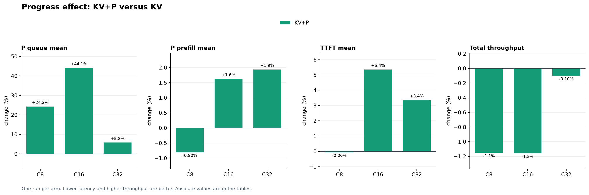
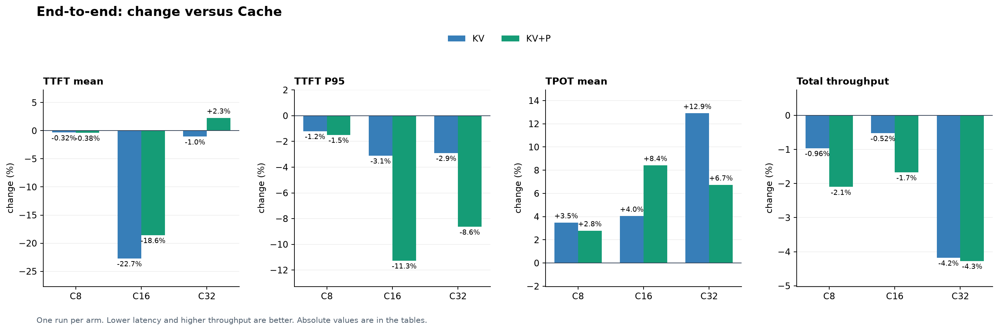

<!-- colocated-prefill-pressure:start -->
## Performance

### Experiment setup

| Item | Setting |
| --- | --- |
| Workers | Four colocated B300 workers; Qwen3-4B-Instruct-2507, BF16, TP1; 48 GiB GPU KV and 16 GiB CPU KV offload per worker |
| vLLM | Prefix caching enabled; max model length 196,608; max batched tokens 131,072; max 16 sequences per worker |
| Workload | AgentInfer AgentX replay, 128 sessions and 721 requests, up to four rounds plus subagents; 33,618,176 input and 425,651 output tokens. Token IDs are reconstructed from trace hash snapshots. |
| Replay | Maximum concurrent sessions C8/C16/C32; at most one request in flight per session; same-agent gaps scaled to zero. Every arm starts cold and is run once. |
| Policies | Cache: cache-aware; KV: KV-aware without affinity; KV+P: KV-aware plus prefill progress. Ties use in-flight context; unknown context falls back to active requests, then random. KV temperature 0; Cache threshold 0.3 and balance thresholds 64/1.5; progress stale threshold 5 s. |
| Revisions | Router `b2a1f411d5bb`, vLLM `d16847dafe12`; every arm uses the same Router binary and GPUs 2/3/4/7. |

All runs completed 721 requests, without KV-event warnings or foreign processes on the selected GPUs; the host was shared. Each cell is a single run, so changes do not establish repeatability.

### 1. What does prefill progress improve?

KV → KV+P at the same concurrency. Parentheses show relative change; local P hit changes are percentage points. Lower latency and less new P work are better; higher throughput is better.

| C | Local P hit, % | New P tokens, M | P queue, ms | P prefill, ms | TTFT mean / P95, ms | Total token/s |
| ---: | --- | --- | --- | --- | --- | --- |
| 8 | 69.45 → 69.76 (+0.32 pp) | 10.27 → 10.16 (-1.04%) | 0.21 → 0.27 (+24.31%) | 364.21 → 361.29 (-0.80%) | 390.88 → 390.65 (-0.06%) 1,622.51 → 1,617.70 (-0.30%) | 82,524 → 81,576 (-1.15%) |
| 16 | 68.34 → 67.63 (-0.71 pp) | 10.63 → 10.77 (+1.34%) | 45.38 → 65.40 (+44.12%) | 420.49 → 427.34 (+1.63%) | 517.54 → 545.28 (+5.36%) 2,249.35 → 2,059.91 (-8.42%) | 90,524 → 89,477 (-1.16%) |
| 32 | 21.29 → 20.27 (-1.02 pp) | 24.72 → 25.09 (+1.51%) | 3,587.70 → 3,795.51 (+5.79%) | 1,230.22 → 1,254.05 (+1.94%) | 5,037.88 → 5,207.23 (+3.36%) 14,519.74 → 13,662.67 (-5.90%) | 76,327 → 76,252 (-0.10%) |

P queue is time from worker admission to scheduling; P prefill is scheduling to the first worker token, so it includes scheduling effects and is not pure GPU compute. TTFT also includes Router, transport and client overhead.

| C | Matched requests with lower TTFT | Local-hit token change | External-hit token change | New P token change |
| ---: | ---: | ---: | ---: | ---: |
| 8 | 381 / 721 | +106,672 | +32 | -106,704 |
| 16 | 346 / 721 | -238,912 | +96,352 | +142,560 |
| 32 | 344 / 721 | -342,784 | -30,160 | +372,944 |

Local and external hit changes together determine the change in newly computed prompt tokens for this fixed workload. Matched requests can have different arrival times and placements in closed-loop replay; these observations do not isolate per-request routing causes.

### 2. End-to-end: KV-aware versus Cache-aware

Percentages compare each policy with Cache at the same concurrency. Total token/s is logical input plus output tokens divided by replay wall time, including cached input.

| C | Policy | TTFT mean / P95, ms | TPOT mean, ms | Session JCT mean, s | Total token/s |
| ---: | --- | --- | ---: | ---: | ---: |
| 8 | Cache | 392.12 1,642.20 | 5.57 | 22.26 | 83,326 |
| 8 | KV | 390.88 (-0.32%) 1,622.51 (-1.20%) | 5.77 (+3.48%) | 22.01 (-1.14%) | 82,524 (-0.96%) |
| 8 | KV+P | 390.65 (-0.38%) 1,617.70 (-1.49%) | 5.73 (+2.79%) | 22.46 (+0.88%) | 81,576 (-2.10%) |
| 16 | Cache | 669.54 2,321.38 | 10.37 | 34.70 | 90,999 |
| 16 | KV | 517.54 (-22.70%) 2,249.35 (-3.10%) | 10.78 (+4.05%) | 34.36 (-0.99%) | 90,524 (-0.52%) |
| 16 | KV+P | 545.28 (-18.56%) 2,059.91 (-11.26%) | 11.24 (+8.42%) | 34.35 (-1.02%) | 89,477 (-1.67%) |
| 32 | Cache | 5,091.15 14,953.22 | 19.72 | 77.44 | 79,653 |
| 32 | KV | 5,037.88 (-1.05%) 14,519.74 (-2.90%) | 22.27 (+12.91%) | 78.72 (+1.65%) | 76,327 (-4.18%) |
| 32 | KV+P | 5,207.23 (+2.28%) 13,662.67 (-8.63%) | 21.05 (+6.74%) | 78.82 (+1.78%) | 76,252 (-4.27%) |

#### Scaling from C16 to C32

Each row compares the same policy as concurrency increases; changes in cache reuse, queueing and decode latency help interpret throughput, but do not establish their individual causal contributions.

| Policy | Local P hit, % | New P tokens, M | External-hit tokens, M | P queue, ms | P prefill, ms | TPOT mean, ms | Total token/s |
| --- | --- | --- | --- | --- | --- | --- | --- |
| Cache | 68.83 → 27.80 (-41.02 pp) | 10.44 → 22.33 (+113.97%) | 0.04 → 1.94 (43.6×) | 168.40 → 3,759.18 (22.3×) | 445.66 → 1,162.46 (+160.84%) | 10.37 → 19.72 (+90.26%) | 90,999 → 79,653 (-12.47%) |
| KV | 68.34 → 21.29 (-47.06 pp) | 10.63 → 24.72 (+132.61%) | 0.02 → 1.75 (100.4×) | 45.38 → 3,587.70 (79.1×) | 420.49 → 1,230.22 (+192.57%) | 10.78 → 22.27 (+106.46%) | 90,524 → 76,327 (-15.68%) |
| KV+P | 67.63 → 20.27 (-47.36 pp) | 10.77 → 25.09 (+133.00%) | 0.11 → 1.72 (15.1×) | 65.40 → 3,795.51 (58.0×) | 427.34 → 1,254.05 (+193.46%) | 11.24 → 21.05 (+87.31%) | 89,477 → 76,252 (-14.78%) |

For the same token volume, lower logical throughput means a longer replay wall time. The table shows the accompanying changes in work, queue and TPOT; one run cannot attribute the wall-time change to individual factors.

Input/output throughput and full latency distributions

TTFT and TPOT are per request. Client-observed TPOT is (request latency − TTFT) / (output tokens − 1), including transport and stream completion overhead; one request with fewer than two output tokens is excluded. JCT is session duration across multiple model requests; no real tools are executed. Distributions are mean / P50 / P95 / P99.

| C | Policy | Input / output / total token/s | TTFT, ms | TPOT, ms | Session JCT, s |
| ---: | --- | --- | --- | --- | --- |
| 8 | Cache | 82,284 / 1,042 / 83,326 | 392.12 / 96.79 / 1,642.20 / 3,279.03 | 5.57 / 5.09 / 8.66 / 12.97 | 22.26 / 11.56 / 101.14 / 132.79 |
| 8 | KV | 81,492 / 1,032 / 82,524 | 390.88 / 106.67 / 1,622.51 / 2,804.99 | 5.77 / 5.13 / 8.72 / 16.47 | 22.01 / 11.31 / 95.57 / 140.82 |
| 8 | KV+P | 80,556 / 1,020 / 81,576 | 390.65 / 104.06 / 1,617.70 / 2,892.94 | 5.73 / 5.15 / 9.39 / 14.15 | 22.46 / 10.92 / 99.33 / 136.42 |
| 16 | Cache | 89,861 / 1,138 / 90,999 | 669.54 / 153.85 / 2,321.38 / 7,756.94 | 10.37 / 8.80 / 18.80 / 46.29 | 34.70 / 20.60 / 118.20 / 196.44 |
| 16 | KV | 89,393 / 1,132 / 90,524 | 517.54 / 150.12 / 2,249.35 / 4,151.81 | 10.78 / 9.01 / 17.24 / 49.27 | 34.36 / 20.26 / 127.86 / 199.27 |
| 16 | KV+P | 88,358 / 1,119 / 89,477 | 545.28 / 158.24 / 2,059.91 / 5,214.29 | 11.24 / 8.80 / 21.40 / 75.87 | 34.35 / 19.31 / 136.99 / 204.10 |
| 32 | Cache | 78,657 / 996 / 79,653 | 5,091.15 / 3,547.64 / 14,953.22 / 23,064.85 | 19.72 / 15.45 / 40.98 / 141.89 | 77.44 / 57.83 / 218.41 / 373.54 |
| 32 | KV | 75,373 / 954 / 76,327 | 5,037.88 / 3,727.29 / 14,519.74 / 25,724.13 | 22.27 / 16.20 / 36.40 / 230.76 | 78.72 / 58.85 / 226.99 / 364.04 |
| 32 | KV+P | 75,299 / 953 / 76,252 | 5,207.23 / 4,356.96 / 13,662.67 / 19,306.31 | 21.05 / 15.33 / 34.82 / 160.95 | 78.82 / 58.04 / 262.62 / 349.58 |

Changes below are relative to Cache at the same concurrency (mean / P50 / P95 / P99).

| C | Policy | TTFT change | TPOT change | Session JCT change |
| ---: | --- | --- | --- | --- |
| 8 | KV | -0.32% / +10.21% / -1.20% / -14.46% | +3.48% / +0.76% / +0.72% / +26.92% | -1.14% / -2.24% / -5.51% / +6.05% |
| 8 | KV+P | -0.38% / +7.52% / -1.49% / -11.77% | +2.79% / +1.16% / +8.45% / +9.03% | +0.88% / -5.61% / -1.79% / +2.74% |
| 16 | KV | -22.70% / -2.42% / -3.10% / -46.48% | +4.05% / +2.39% / -8.31% / +6.43% | -0.99% / -1.62% / +8.17% / +1.44% |
| 16 | KV+P | -18.56% / +2.86% / -11.26% / -32.78% | +8.42% / +0.07% / +13.79% / +63.88% | -1.02% / -6.24% / +15.89% / +3.90% |
| 32 | KV | -1.05% / +5.06% / -2.90% / +11.53% | +12.91% / +4.86% / -11.17% / +62.64% | +1.65% / +1.78% / +3.93% / -2.55% |
| 32 | KV+P | +2.28% / +22.81% / -8.63% / -16.30% | +6.74% / -0.78% / -15.03% / +13.43% | +1.78% / +0.38% / +20.24% / -6.42% |

Worker-level cache, work, queue and prefill

Local hit = locally cached prompt tokens / prompt tokens. New P = first-computed prompt tokens; iteration tokens include prefill and decode and are a work proxy, not FLOPs. Queue/prefill percentile values are Prometheus histogram bucket bounds. Colocated workers share P/D cache; there is no P→D KV transfer and preemptions cannot be split into P versus D.

| C | Policy | Local hit % | New P / iteration / external-hit tokens | Queue mean / P50 / P95 / P99, ms | Prefill mean / P50 / P95 / P99, ms | Decode mean, s | Preemptions | Requests W0/W1/W2/W3 |
| ---: | --- | ---: | --- | --- | --- | ---: | ---: | --- |
| 8 | Cache | 70.07 | 10,060,848 / 10,486,499 / 144 | 0.21 / 0–300 / 0–300 / 0–300 | 366.95 / 0–300 / 1,500–2,000 / 2,500–5,000 | 3.47 | 0 | 182/165/181/193 |
| 8 | KV | 69.45 | 10,271,088 / 10,696,739 / 144 | 0.21 / 0–300 / 0–300 / 0–300 | 364.21 / 0–300 / 1,500–2,000 / 2,500–5,000 | 3.40 | 0 | 194/167/166/194 |
| 8 | KV+P | 69.76 | 10,164,384 / 10,590,035 / 176 | 0.27 / 0–300 / 0–300 / 0–300 | 361.29 / 0–300 / 1,500–2,000 / 2,500–5,000 | 3.49 | 0 | 207/148/218/148 |
| 16 | Cache | 68.83 | 10,435,184 / 10,860,835 / 44,560 | 168.40 / 0–300 / 0–300 / 5,000–10,000 | 445.66 / 0–300 / 1,500–2,000 / 2,500–5,000 | 5.42 | 1 | 214/97/227/183 |
| 16 | KV | 68.34 | 10,625,696 / 11,051,347 / 17,392 | 45.38 / 0–300 / 0–300 / 2,000–2,500 | 420.49 / 0–300 / 1,500–2,000 / 2,500–5,000 | 5.50 | 1 | 192/214/173/142 |
| 16 | KV+P | 67.63 | 10,768,256 / 11,193,907 / 113,744 | 65.40 / 0–300 / 0–300 / 2,000–2,500 | 427.34 / 0–300 / 1,500–2,000 / 2,500–5,000 | 5.47 | 2 | 183/141/164/233 |
| 32 | Cache | 27.80 | 22,327,856 / 22,753,507 / 1,943,136 | 3759.18 / 1,500–2,000 / 10,000–15,000 / 20,000–30,000 | 1162.46 / 800–1,000 / 2,500–5,000 / 5,000–10,000 | 8.60 | 3 | 142/239/210/130 |
| 32 | KV | 21.29 | 24,716,832 / 25,142,483 / 1,745,568 | 3587.70 / 2,000–2,500 / 10,000–15,000 / 20,000–30,000 | 1230.22 / 800–1,000 / 2,500–5,000 / 5,000–10,000 | 8.88 | 10 | 221/139/116/245 |
| 32 | KV+P | 20.27 | 25,089,776 / 25,515,427 / 1,715,408 | 3795.51 / 2,500–5,000 / 10,000–15,000 / 15,000–20,000 | 1254.05 / 800–1,000 / 2,500–5,000 / 5,000–10,000 | 8.73 | 8 | 174/126/242/179 |

| C | Policy | Worker | Requests | Local hit % | New P tokens | Queue / prefill mean, ms | Waiting mean / P50 / P95 / P99 | KV usage mean / P95, % | Preemptions |
| ---: | --- | ---: | ---: | ---: | ---: | --- | --- | --- | ---: |
| 8 | Cache | 0 | 182 | 61.88 | 2,850,176 | 0.29 / 401.26 | 0.000 / 0 / 0 / 0 | 27.0 / 61.9 | 0 |
| 8 | Cache | 1 | 165 | 65.71 | 2,680,384 | 0.24 / 413.17 | 0.000 / 0 / 0 / 0 | 37.0 / 89.7 | 0 |
| 8 | Cache | 2 | 181 | 72.93 | 2,500,160 | 0.01 / 385.24 | 0.000 / 0 / 0 / 0 | 35.8 / 82.4 | 0 |
| 8 | Cache | 3 | 193 | 77.66 | 2,030,128 | 0.28 / 277.95 | 0.002 / 0 / 0 / 0 | 31.8 / 65.2 | 0 |
| 8 | KV | 0 | 194 | 69.07 | 2,796,048 | 0.16 / 360.61 | 0.000 / 0 / 0 / 0 | 29.6 / 74.0 | 0 |
| 8 | KV | 1 | 167 | 64.67 | 2,851,664 | 0.22 / 455.47 | 0.000 / 0 / 0 / 0 | 31.7 / 56.8 | 0 |
| 8 | KV | 2 | 166 | 62.34 | 2,671,184 | 0.31 / 383.59 | 0.000 / 0 / 0 / 0 | 27.7 / 54.4 | 0 |
| 8 | KV | 3 | 194 | 79.26 | 1,952,192 | 0.18 / 272.68 | 0.000 / 0 / 0 / 0 | 35.0 / 75.7 | 0 |
| 8 | KV+P | 0 | 207 | 72.45 | 2,603,072 | 0.50 / 325.54 | 0.000 / 0 / 0 / 0 | 27.3 / 53.4 | 0 |
| 8 | KV+P | 1 | 148 | 65.82 | 2,270,368 | 0.06 / 354.83 | 0.000 / 0 / 0 / 0 | 31.3 / 63.4 | 0 |
| 8 | KV+P | 2 | 218 | 72.96 | 2,765,056 | 0.15 / 342.73 | 0.000 / 0 / 0 / 0 | 32.0 / 57.0 | 0 |
| 8 | KV+P | 3 | 148 | 65.40 | 2,525,888 | 0.31 / 445.06 | 0.000 / 0 / 0 / 0 | 36.1 / 65.4 | 0 |
| 16 | Cache | 0 | 214 | 70.34 | 3,134,096 | 52.43 / 454.70 | 0.033 / 0 / 0 / 1 | 51.4 / 90.5 | 1 |
| 16 | Cache | 1 | 97 | 57.80 | 2,152,160 | 1134.86 / 784.77 | 0.291 / 0 / 2 / 2 | 49.4 / 86.4 | 0 |
| 16 | Cache | 2 | 227 | 78.45 | 2,180,816 | 0.13 / 287.77 | 0.000 / 0 / 0 / 0 | 55.9 / 79.9 | 0 |
| 16 | Cache | 3 | 183 | 61.58 | 2,968,112 | 0.47 / 451.21 | 0.000 / 0 / 0 / 0 | 46.0 / 86.3 | 0 |
| 16 | KV | 0 | 192 | 67.19 | 2,941,456 | 65.10 / 460.36 | 0.014 / 0 / 0 / 1 | 51.4 / 82.6 | 0 |
| 16 | KV | 1 | 214 | 72.58 | 2,485,376 | 0.14 / 298.22 | 0.000 / 0 / 0 / 0 | 45.4 / 74.7 | 0 |
| 16 | KV | 2 | 173 | 68.61 | 2,648,736 | 49.89 / 434.71 | 0.022 / 0 / 0 / 1 | 55.0 / 96.2 | 1 |
| 16 | KV | 3 | 142 | 64.09 | 2,550,128 | 81.40 / 533.51 | 0.025 / 0 / 0 / 1 | 55.0 / 92.9 | 0 |
| 16 | KV+P | 0 | 183 | 68.92 | 2,335,200 | 257.19 / 395.56 | 0.146 / 0 / 1 / 2 | 51.2 / 95.9 | 1 |
| 16 | KV+P | 1 | 141 | 70.03 | 2,222,224 | 0.27 / 446.73 | 0.016 / 0 / 0 / 1 | 52.5 / 88.0 | 1 |
| 16 | KV+P | 2 | 164 | 60.19 | 2,881,664 | 0.17 / 472.31 | 0.000 / 0 / 0 / 0 | 47.8 / 88.4 | 0 |
| 16 | KV+P | 3 | 233 | 69.96 | 3,329,168 | 0.10 / 408.91 | 0.000 / 0 / 0 / 0 | 49.5 / 89.9 | 0 |
| 32 | Cache | 0 | 142 | 14.53 | 5,208,080 | 4573.50 / 1479.87 | 1.415 / 1 / 4 / 5 | 68.1 / 98.9 | 3 |
| 32 | Cache | 1 | 239 | 39.20 | 5,885,360 | 2120.81 / 796.45 | 1.046 / 0 / 4 / 5 | 66.1 / 99.0 | 0 |
| 32 | Cache | 2 | 210 | 28.47 | 6,250,720 | 3202.82 / 1010.60 | 1.465 / 1 / 4 / 5 | 67.4 / 98.9 | 0 |
| 32 | Cache | 3 | 130 | 22.87 | 4,983,696 | 6780.51 / 1733.95 | 1.965 / 2 / 4 / 5 | 76.4 / 98.6 | 0 |
| 32 | KV | 0 | 221 | 18.15 | 6,502,624 | 2480.40 / 907.76 | 1.124 / 1 / 4 / 4 | 70.6 / 99.0 | 1 |
| 32 | KV | 1 | 139 | 16.68 | 6,021,440 | 5037.98 / 1735.96 | 1.513 / 1 / 4 / 5 | 64.9 / 98.1 | 1 |
| 32 | KV | 2 | 116 | 13.38 | 4,845,824 | 6603.80 / 1658.24 | 1.686 / 1 / 5 / 6 | 68.8 / 99.4 | 5 |
| 32 | KV | 3 | 245 | 30.90 | 7,346,944 | 2335.68 / 1031.50 | 1.187 / 1 / 4 / 5 | 67.4 / 99.2 | 3 |
| 32 | KV+P | 0 | 174 | 21.03 | 5,713,808 | 3390.39 / 1292.99 | 1.307 / 1 / 4 / 5 | 66.2 / 99.5 | 3 |
| 32 | KV+P | 1 | 126 | 13.05 | 5,795,056 | 6042.98 / 1744.40 | 1.624 / 1 / 5 / 6 | 66.1 / 99.2 | 1 |
| 32 | KV+P | 2 | 242 | 24.54 | 7,188,592 | 2838.67 / 1001.21 | 1.379 / 1 / 4 / 5 | 67.0 / 99.0 | 0 |
| 32 | KV+P | 3 | 179 | 20.39 | 6,392,320 | 3900.88 / 1212.87 | 1.471 / 1 / 4 / 5 | 74.7 / 99.2 | 4 |

Waiting and KV usage are time-weighted worker samples; waiting is a queue size, not a per-request latency distribution.

| C | Policy | Smaller context | Context tie, random | Unknown: fewer active | Unknown: equal active, random |
| ---: | --- | ---: | ---: | ---: | ---: |
| 8 | KV | 53 | 14 | 0 | 0 |
| 8 | KV+P | 46 | 13 | 0 | 0 |
| 16 | KV | 50 | 13 | 0 | 0 |
| 16 | KV+P | 34 | 14 | 0 | 0 |
| 32 | KV | 5 | 14 | 0 | 0 |
| 32 | KV+P | 5 | 15 | 0 | 0 |

These are equal-cost tie-break decisions; they do not by themselves establish performance impact.

<!-- colocated-prefill-pressure:end -->
