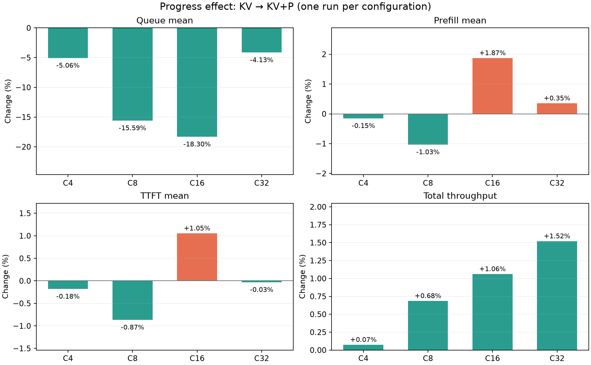
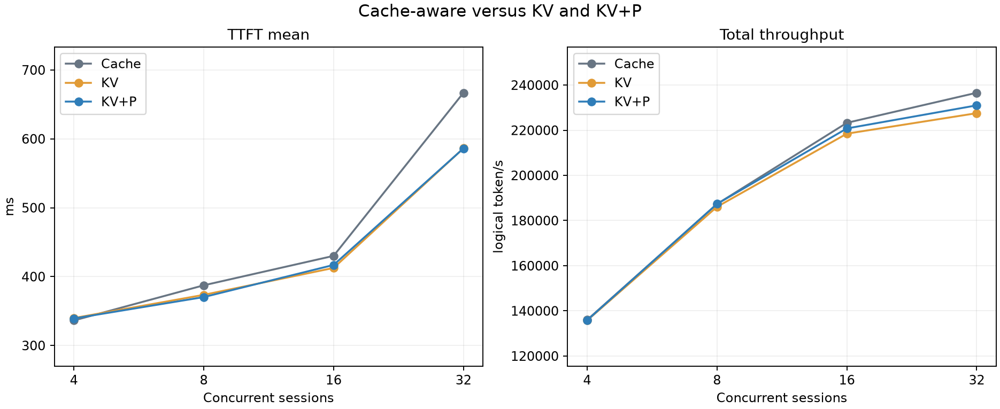

# Colocated KV progress benchmark

<!-- colocated-prefill-pressure:start -->
## Experiment

Four colocated Qwen3-4B-Instruct-2507 BF16/TP1 gRPC workers on four B300 GPUs; 128 GiB KV per worker. [AgentInfer](https://github.com/openJiuwen-ai/agent-infer/blob/main/docs/zh/how-to/run-trace-replay.md) replays 128 sessions and their first four requests from the [AgentX snapshot](https://huggingface.co/datasets/semianalysisai/cc-traces-weka-062126/tree/23f152f6f0f9399a85901b89a6458def0ef16729): 21,739,008 input and 111,278 output tokens per run.

**Scope:** deliberately prefill-heavy, not representative. From 217 eligible sessions (at most 2,048 output tokens and at least 32,768 estimated novel prompt tokens across four requests), the 128 with shortest output totals were selected. Replay preserves source lengths and hash-block sharing while reconstructing token IDs; same-agent gaps are zero and each session has at most one request in flight.

**Configurations:** Cache = cache-aware; KV = KV-aware; KV+P = KV-aware with progress. Session binding is disabled in both KV runs. C4/C8/C16/C32 limit concurrent sessions. Each configuration ran once, with other host/GPU activity not fully isolated. Router `cf5bc54`; vLLM `d16847d`.

## 1. What does prefill progress improve?

**Result:** sampled remaining-work estimates are closer to worker progress; the measured end-to-end effect varies with concurrency.

**KV → KV+P** isolates the Progress switch. Cells show before → after and relative change; hit-rate changes are percentage points. Queue is queued → scheduled; prefill is scheduled → first worker token.

| C | Local hit % | New prompt tokens | Queue mean ms | Prefill mean ms | TTFT mean ms | Total token/s |
| --- | ---: | ---: | ---: | ---: | ---: | ---: |
| C4 | 62.28 → 62.44 (+0.16 pp) | 8,200,112 → 8,164,592 (-0.43%) | 0.0078 → 0.0074 (-5.06%) | 323.55 → 323.07 (-0.15%) | 339.81 → 339.20 (-0.18%) | 135,735.66 → 135,833.89 (+0.07%) |
| C8 | 61.15 → 61.87 (+0.72 pp) | 8,445,728 → 8,288,144 (-1.87%) | 6.0008 → 5.0655 (-15.59%) | 342.67 → 339.14 (-1.03%) | 373.49 → 370.26 (-0.87%) | 186,065.37 → 187,338.76 (+0.68%) |
| C16 | 61.70 → 61.77 (+0.07 pp) | 8,326,144 → 8,310,480 (-0.19%) | 17.5578 → 14.3439 (-18.30%) | 351.85 → 358.43 (+1.87%) | 412.58 → 416.92 (+1.05%) | 218,473.57 → 220,789.80 (+1.06%) |
| C32 | 61.22 → 61.82 (+0.61 pp) | 8,431,328 → 8,299,232 (-1.57%) | 121.9662 → 116.9273 (-4.13%) | 389.59 → 390.95 (+0.35%) | 586.30 → 586.12 (-0.03%) | 227,549.38 → 231,005.29 (+1.52%) |

- **Accounting:** separate instrumented 32-session C16/C32 runs sample mean absolute remaining-work error at confirmed worker scheduling steps:
  - C16: 15,901.38 → 4,308.12 tokens (-72.91%; 476/477 samples).
  - C32: 15,979.63 → 4,247.39 tokens (-73.42%; 484/496 samples).
  Samples and execution trajectories differ; this confirms fresher accounting, not a controlled latency attribution.
- **C8:** less new prompt work and lower queue/prefill accompany a 0.87% TTFT decrease and 0.68% throughput increase.
- **C16:** queue falls by 3.21 ms, but prefill rises by 6.58 ms and TTFT rises by 4.34 ms. Aggregate data does not isolate why worker prefill increased.
- **C4:** queue changes by less than 0.001 ms; its percentage is sensitive to a near-zero baseline.

## 2. End-to-end: KV+P versus Cache

Cells show Cache → KV+P and relative change. Logical input throughput includes cache hits; total throughput is input + output, not computed GPU tokens/s.

| C | TTFT mean ms | TTFT P95 ms | TPOT mean ms | JCT mean s | Total token/s |
| --- | ---: | ---: | ---: | ---: | ---: |
| C4 | 336.30 → 339.20 (+0.86%) | 1,261.88 → 1,272.65 (+0.85%) | 3.64 → 3.62 (-0.42%) | 4.98 → 4.99 (+0.21%) | 135,979.51 → 135,833.89 (-0.11%) |
| C8 | 387.35 → 370.26 (-4.41%) | 1,473.01 → 1,312.29 (-10.91%) | 6.00 → 6.10 (+1.63%) | 7.12 → 7.13 (+0.04%) | 187,303.03 → 187,338.76 (+0.02%) |
| C16 | 430.09 → 416.92 (-3.06%) | 1,527.24 → 1,586.89 (+3.91%) | 11.50 → 12.06 (+4.85%) | 11.77 → 11.99 (+1.83%) | 223,276.69 → 220,789.80 (-1.11%) |
| C32 | 666.90 → 586.12 (-12.11%) | 2,642.68 → 2,699.86 (+2.16%) | 24.86 → 24.58 (-1.13%) | 21.73 → 22.28 (+2.54%) | 236,591.38 → 231,005.29 (-2.36%) |

- **C8:** TTFT mean/P95 improve 4.41%/10.91%, while total throughput is essentially unchanged (+0.02%).
- **C16:** TTFT mean improves 3.06%, but P95 worsens 3.91%; mean decode rises 2,463.96 → 2,529.66 ms and TPOT rises 4.85%. These observations do not establish causality.
- **C32:** queue falls 170.69 → 116.93 ms and prefill 403.55 → 390.95 ms. TTFT mean falls 12.11%, while mean decode rises 4,723.01 → 4,939.93 ms, JCT rises 2.54% and throughput falls 2.36%. TTFT P95 rises 2.16% but P99 falls 38.08%; the source of the tail change is not isolated.

Throughput and latency distributions for all three configurations

| C | Config | Input token/s | Output token/s | Total token/s |
| --- | --- | ---: | ---: | ---: |
| C4 | Cache | 135,287.00 | 692.51 | 135,979.51 |
| C4 | KV | 135,044.39 | 691.27 | 135,735.66 |
| C4 | KV+P | 135,142.12 | 691.77 | 135,833.89 |
| C8 | Cache | 186,349.14 | 953.89 | 187,303.03 |
| C8 | KV | 185,117.78 | 947.58 | 186,065.37 |
| C8 | KV+P | 186,384.69 | 954.07 | 187,338.76 |
| C16 | Cache | 222,139.60 | 1,137.09 | 223,276.69 |
| C16 | KV | 217,360.94 | 1,112.63 | 218,473.57 |
| C16 | KV+P | 219,665.37 | 1,124.43 | 220,789.80 |
| C32 | Cache | 235,386.48 | 1,204.90 | 236,591.38 |
| C32 | KV | 226,390.53 | 1,158.85 | 227,549.38 |
| C32 | KV+P | 229,828.83 | 1,176.45 | 231,005.29 |

For KV and KV+P, cells show Cache → configuration and relative change; Cache rows show absolute values. TPOT = (request latency − TTFT) / (output tokens − 1), for requests with more than one output token. JCT is replay session duration without real tool execution.

| C | Config | Metric | Mean | P50 | P95 | P99 |
| --- | --- | --- | ---: | ---: | ---: | ---: |
| C4 | Cache | TTFT ms | 336.30 | 68.47 | 1,261.88 | 2,583.77 |
| C4 | Cache | TPOT ms | 3.64 | 3.70 | 4.68 | 5.83 |
| C4 | Cache | JCT s | 4.98 | 4.92 | 8.04 | 13.02 |
| C4 | KV | TTFT ms | 336.30 → 339.81 (+1.04%) | 68.47 → 71.15 (+3.91%) | 1,261.88 → 1,273.48 (+0.92%) | 2,583.77 → 2,585.56 (+0.07%) |
| C4 | KV | TPOT ms | 3.64 → 3.63 (-0.16%) | 3.70 → 3.70 (-0.04%) | 4.68 → 4.69 (+0.15%) | 5.83 → 5.86 (+0.42%) |
| C4 | KV | JCT s | 4.98 → 4.99 (+0.24%) | 4.92 → 4.91 (-0.26%) | 8.04 → 8.02 (-0.24%) | 13.02 → 13.17 (+1.11%) |
| C4 | KV+P | TTFT ms | 336.30 → 339.20 (+0.86%) | 68.47 → 72.57 (+5.99%) | 1,261.88 → 1,272.65 (+0.85%) | 2,583.77 → 2,582.25 (-0.06%) |
| C4 | KV+P | TPOT ms | 3.64 → 3.62 (-0.42%) | 3.70 → 3.70 (-0.19%) | 4.68 → 4.67 (-0.08%) | 5.83 → 5.84 (+0.09%) |
| C4 | KV+P | JCT s | 4.98 → 4.99 (+0.21%) | 4.92 → 4.93 (+0.12%) | 8.04 → 8.05 (+0.22%) | 13.02 → 13.03 (+0.08%) |
| C8 | Cache | TTFT ms | 387.35 | 75.39 | 1,473.01 | 3,187.46 |
| C8 | Cache | TPOT ms | 6.00 | 5.07 | 9.56 | 18.78 |
| C8 | Cache | JCT s | 7.12 | 6.98 | 12.01 | 15.07 |
| C8 | KV | TTFT ms | 387.35 → 373.49 (-3.58%) | 75.39 → 78.24 (+3.78%) | 1,473.01 → 1,348.04 (-8.48%) | 3,187.46 → 2,906.13 (-8.83%) |
| C8 | KV | TPOT ms | 6.00 → 6.26 (+4.28%) | 5.07 → 5.11 (+0.87%) | 9.56 → 10.40 (+8.77%) | 18.78 → 25.56 (+36.11%) |
| C8 | KV | JCT s | 7.12 → 7.23 (+1.47%) | 6.98 → 7.12 (+1.89%) | 12.01 → 12.70 (+5.78%) | 15.07 → 17.88 (+18.67%) |
| C8 | KV+P | TTFT ms | 387.35 → 370.26 (-4.41%) | 75.39 → 79.22 (+5.08%) | 1,473.01 → 1,312.29 (-10.91%) | 3,187.46 → 2,609.09 (-18.15%) |
| C8 | KV+P | TPOT ms | 6.00 → 6.10 (+1.63%) | 5.07 → 5.09 (+0.46%) | 9.56 → 10.13 (+5.92%) | 18.78 → 27.61 (+47.06%) |
| C8 | KV+P | JCT s | 7.12 → 7.13 (+0.04%) | 6.98 → 7.09 (+1.57%) | 12.01 → 11.67 (-2.78%) | 15.07 → 15.98 (+6.10%) |
| C16 | Cache | TTFT ms | 430.09 | 89.99 | 1,527.24 | 2,715.72 |
| C16 | Cache | TPOT ms | 11.50 | 9.05 | 22.78 | 59.13 |
| C16 | Cache | JCT s | 11.77 | 11.50 | 19.07 | 23.42 |
| C16 | KV | TTFT ms | 430.09 → 412.58 (-4.07%) | 89.99 → 90.18 (+0.20%) | 1,527.24 → 1,576.62 (+3.23%) | 2,715.72 → 2,686.87 (-1.06%) |
| C16 | KV | TPOT ms | 11.50 → 11.73 (+1.99%) | 9.05 → 9.67 (+6.81%) | 22.78 → 21.83 (-4.19%) | 59.13 → 39.82 (-32.66%) |
| C16 | KV | JCT s | 11.77 → 12.05 (+2.32%) | 11.50 → 12.40 (+7.75%) | 19.07 → 20.77 (+8.94%) | 23.42 → 23.52 (+0.41%) |
| C16 | KV+P | TTFT ms | 430.09 → 416.92 (-3.06%) | 89.99 → 90.06 (+0.07%) | 1,527.24 → 1,586.89 (+3.91%) | 2,715.72 → 2,922.16 (+7.60%) |
| C16 | KV+P | TPOT ms | 11.50 → 12.06 (+4.85%) | 9.05 → 9.45 (+4.42%) | 22.78 → 24.60 (+8.01%) | 59.13 → 54.03 (-8.63%) |
| C16 | KV+P | JCT s | 11.77 → 11.99 (+1.83%) | 11.50 → 11.91 (+3.54%) | 19.07 → 21.94 (+15.09%) | 23.42 → 25.23 (+7.70%) |
| C32 | Cache | TTFT ms | 666.90 | 142.81 | 2,642.68 | 7,031.79 |
| C32 | Cache | TPOT ms | 24.86 | 18.98 | 74.18 | 123.69 |
| C32 | Cache | JCT s | 21.73 | 21.02 | 36.83 | 42.24 |
| C32 | KV | TTFT ms | 666.90 → 586.30 (-12.09%) | 142.81 → 125.55 (-12.09%) | 2,642.68 → 2,727.24 (+3.20%) | 7,031.79 → 4,567.89 (-35.04%) |
| C32 | KV | TPOT ms | 24.86 → 24.69 (-0.69%) | 18.98 → 19.93 (+5.00%) | 74.18 → 53.37 (-28.05%) | 123.69 → 128.69 (+4.04%) |
| C32 | KV | JCT s | 21.73 → 22.51 (+3.62%) | 21.02 → 22.47 (+6.91%) | 36.83 → 36.59 (-0.63%) | 42.24 → 47.87 (+13.33%) |
| C32 | KV+P | TTFT ms | 666.90 → 586.12 (-12.11%) | 142.81 → 129.12 (-9.59%) | 2,642.68 → 2,699.86 (+2.16%) | 7,031.79 → 4,354.38 (-38.08%) |
| C32 | KV+P | TPOT ms | 24.86 → 24.58 (-1.13%) | 18.98 → 20.52 (+8.12%) | 74.18 → 53.88 (-27.36%) | 123.69 → 127.50 (+3.08%) |
| C32 | KV+P | JCT s | 21.73 → 22.28 (+2.54%) | 21.02 → 22.24 (+5.82%) | 36.83 → 35.88 (-2.57%) | 42.24 → 47.01 (+11.29%) |

Worker cache, work, latency and request distribution

Local hit is cached prompt tokens / prompt tokens. New prompt tokens count first computation; iteration tokens are a work proxy, not FLOPs. Colocated execution has no P→D NIXL handoff. Decode is first → last output token. The waiting count and running count in the CSV are time-weighted worker samples, not per-request latency quantiles.

| C | Config | Local hit % | New prompt | Iteration tokens | Queue / prefill / decode mean ms | Preemptions | Requests W0/W1/W2/W3 |
| --- | --- | ---: | ---: | ---: | --- | ---: | --- |
| C4 | Cache | 62.60 | 8,130,288 | 8,241,566 | 0.0074/321.23/842.14 | 0 | 132/134/131/115 |
| C4 | KV | 62.28 | 8,200,112 | 8,311,390 | 0.0078/323.55/841.81 | 0 | 134/116/129/133 |
| C4 | KV+P | 62.44 | 8,164,592 | 8,275,870 | 0.0074/323.07/842.28 | 0 | 133/137/127/115 |
| C8 | Cache | 62.60 | 8,130,272 | 8,241,550 | 24.6112/338.27/1,334.54 | 0 | 117/119/142/134 |
| C8 | KV | 61.15 | 8,445,728 | 8,557,006 | 6.0008/342.67/1,372.80 | 0 | 136/129/128/119 |
| C8 | KV+P | 61.87 | 8,288,144 | 8,399,422 | 5.0655/339.14/1,352.32 | 0 | 127/135/113/137 |
| C16 | Cache | 61.90 | 8,283,616 | 8,394,894 | 28.3374/359.16/2,463.96 | 0 | 145/120/144/103 |
| C16 | KV | 61.70 | 8,326,144 | 8,437,422 | 17.5578/351.85/2,545.99 | 0 | 130/131/122/129 |
| C16 | KV+P | 61.77 | 8,310,480 | 8,421,758 | 14.3439/358.43/2,529.66 | 0 | 138/109/121/144 |
| C32 | Cache | 61.94 | 8,274,768 | 8,386,046 | 170.6866/403.55/4,723.01 | 0 | 145/126/116/125 |
| C32 | KV | 61.22 | 8,431,328 | 8,542,606 | 121.9662/389.59/5,001.50 | 0 | 157/100/126/129 |
| C32 | KV+P | 61.82 | 8,299,232 | 8,410,510 | 116.9273/390.95/4,939.93 | 0 | 114/130/128/140 |

Worker P50/P95/P99 latency values are histogram bucket bounds in the per-worker CSV; they are not exact percentiles. The CSV also contains sampled waiting/running mean, P50, P95 and P99 and per-worker cache, work and preemptions.

[Summary CSV](./summary.csv) · [Per-worker CSV](./workers.csv) · [Request-level diagnostics](./diagnostic-summary.json) · [Workload selection](./selection.json) · [Download self-contained report and charts](./report.zip).

<!-- colocated-prefill-pressure:end -->
